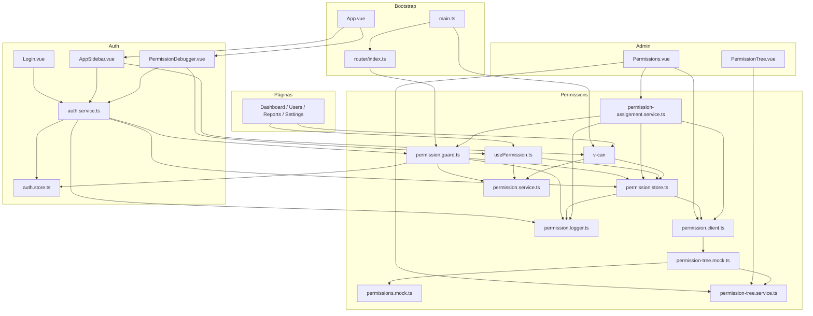
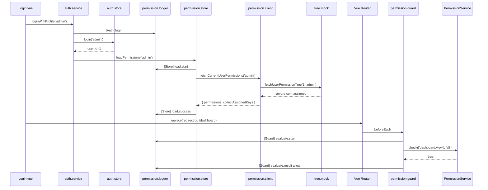

# Arquitetura — Permission-Based Access Control

PoC (Proof of Concept) em Vue 3 (`<script setup>`), TypeScript, Pinia e Vue Router. Autenticação e autorização são mockadas no contrato esperado de um Laravel (`GET /api/me/permissions` e `PUT /api/users/:id/permissions`).

Não há API real. A regra de ouro:

> **Só o Permission Service decide se o usuário pode ou não.** Store guarda estado. Guard, hook, diretiva e páginas apenas perguntam ao Service.

O Laravel continua sendo a fonte definitiva (Gates, Policies, Middleware). O frontend só esconde rotas e botões. Esconder UI não é defesa.

---

## Sumário

1. [O que o sistema responde](#1-o-que-o-sistema-responde)
2. [Mapa das pastas](#2-mapa-das-pastas)
3. [Quem chama quem](#3-quem-chama-quem)
4. [Camadas, uma a uma](#4-camadas-uma-a-uma)
5. [Catálogo e chaves](#5-catálogo-e-chaves)
6. [Fluxos em tempo de execução](#6-fluxos-em-tempo-de-execução)
7. [Rotas, UI e perfis](#7-rotas-ui-e-perfis)
8. [Logger — ordem dos eventos](#8-logger--ordem-dos-eventos)
9. [O que cada camada não pode fazer](#9-o-que-cada-camada-não-pode-fazer)
10. [Integração futura com Laravel](#10-integração-futura-com-laravel)
11. [Como validar](#11-como-validar)
12. [Repositório](#12-repositório)

---

## 1. O que o sistema responde

Três perguntas, em camadas diferentes:

| Pergunta | Quem responde | Onde |
| --- | --- | --- |
| Quem é o usuário? Ele está logado? | Auth Store | `src/modules/auth/stores/auth.store.ts` |
| Quais permissões ele tem agora? | Permission Store | `src/modules/permissions/stores/permission.store.ts` |
| Com essa lista, ele pode fazer X? | Permission Service | `src/modules/permissions/services/permission.service.ts` |

Exemplos de X: abrir `/users`, ver o botão **Excluir**, mostrar **Configurações** na sidebar, habilitar **Aprovar PIX**.

Há três superfícies de proteção:

1. **Rota** — o Vue Router chama o Guard *antes* de entrar na página. Sem permissão, a página não abre (`/403`).
2. **UI** — hook e diretiva escondem links e botões. Isso é só UX.
3. **Catálogo admin** — quem tem `permissions.manage` marca a árvore e persiste a atribuição. Se o alvo é o usuário logado, a sessão muda na hora.

Auth e permissão não se misturam: o Auth Store não avalia `can()`. O Permission Service não sabe quem está logado.

---

## 2. Mapa das pastas

```text
src/
├── main.ts                              # Pinia, Router, v-can
├── App.vue                              # shell (sidebar + debugger) se autenticado
├── router/index.ts                      # rotas + meta.permissions + beforeEach
├── types/vue-router.d.ts                # RouteMeta.permissions / permissionMode
├── mocks/
│   ├── user.mock.ts                     # usuários e diretório
│   ├── permissions.mock.ts              # chaves default por perfil
│   └── permission-tree.mock.ts          # catálogo Sistema + PIX e Map in-memory
├── modules/
│   ├── auth/
│   │   ├── stores/auth.store.ts         # sessão
│   │   └── services/auth.service.ts     # orquestra login / logout / troca de perfil
│   └── permissions/
│       ├── types/permission.types.ts
│       ├── catalog/permissions.ts       # literais recurso.acao (Permission)
│       ├── api/permission.client.ts     # único ponto a virar HTTP
│       ├── services/
│       │   ├── permission.service.ts    # avaliador puro (can / canAny / canAll / check)
│       │   ├── permission-tree.service.ts
│       │   └── permission-assignment.service.ts
│       ├── stores/permission.store.ts
│       ├── guards/permission.guard.ts
│       ├── hooks/usePermission.ts
│       ├── directives/permission.directive.ts
│       └── logger/permission.logger.ts  # fora do Service; Vue-free
├── pages/                               # Login, Dashboard, Users, Permissions, 403…
└── components/
    ├── AppSidebar.vue
    ├── PermissionDebugger.vue
    ├── PermissionTree.vue
    └── PermissionTreeNode.vue
```

---

## 3. Quem chama quem

Setas significam **usa / chama**. O Service não chama ninguém.



Pontos-chave:

- Guard, hook e diretiva **instanciam o Service** com a lista que está no Store. Nunca reimplementam a regra.
- O **Auth Service** é o orquestrador de sessão: fala com os dois stores e, na troca de perfil, pede ao Guard para reavaliar a rota atual (o Router não reexecuta `beforeEach` sozinho quando só o store muda).
- O **Assignment Service** é o orquestrador de admin: persiste a árvore e, se o alvo é o logado, atualiza o Store e reavalia a rota.
- O **Logger** observa Auth, Store, Guard e Admin. O Service **não** emite log — permanece puro.

---

## 4. Camadas, uma a uma

### 4.1 Tipos — `permission.types.ts`

Contrato compartilhado. Nada de Vue.

| Tipo | Papel |
| --- | --- |
| `PERMISSIONS` | `as const` em `catalog/permissions.ts` — todas as chaves `recurso.acao` |
| `Permission` | união desses literais (`users.view`, `financeiras.list`, …). Typo não compila |
| `isPermission` / `retainKnownPermissions` | filtro em runtime (Store descarta chave desconhecida do payload) |
| `PermissionMode` | `'all'` (precisa de todas) ou `'any'` (basta uma) |
| `UserProfile` | `'admin' \| 'operator' \| 'viewer'` — só existe na PoC (Proof of Concept) para alternar personas |
| `PermissionsResponse` | `{ permissions: Permission[] }` — payload de `GET /api/me/permissions` |
| `PermissionDirectiveValue` | string, array, ou `{ permissions, mode }` |
| `PermissionNode` | nó do catálogo Laravel: `uuid`, `description`, `assigned?`, `isCritial?`, `isVisible?`, `isDefault?`, `children`, `key?` |
| `PermissionCheckState` | `'checked' \| 'unchecked' \| 'indeterminate'` na árvore |

Nó **grantable**: tem `assigned: boolean` e **obrigatoriamente** `key`. Nó **grupo**: não tem `assigned`; só organiza filhos. `key` ausente em nó grantable é erro (`nodePermissionKey` lança). Não existe fallback por `uuid`.

`RouteMeta` em `src/types/vue-router.d.ts` adiciona `requiresAuth`, `permissions` e `permissionMode` às rotas.

### 4.2 Auth Store — `useAuthStore`

**Faz:** sessão. Usuário mockado, perfil atual, `isAuthenticated`.

**Não faz:** carregar permissões, avaliar `can()`, redirecionar, falar com o catálogo.

| Estado / método | Função |
| --- | --- |
| `user` | `{ id, name, email, authenticated }` ou `null` |
| `currentProfile` | `admin` / `operator` / `viewer` ou `null` |
| `isAuthenticated` | `user.authenticated === true` |
| `login(profile)` | copia o usuário de `mockUsersByProfile` |
| `logout()` | zera usuário e perfil |

Quem chama: só `auth.service.ts` para mutar. Sidebar, Dashboard e Debugger *leem* nome/perfil.

### 4.3 Auth Service — `loginWithProfile` / `logout` / `switchProfile`

**Faz:** coordenar os dois stores para a UI não orquestrar sessão.

```text
loginWithProfile(profile)
  → logger.trace('auth', 'login')
  → authStore.login(profile)
  → permissionStore.loadPermissions(profile)

logout()
  → logger.trace('auth', 'logout')
  → authStore.logout()
  → permissionStore.clearPermissions()

switchProfile(profile, router)
  → logger.trace('auth', 'switch')
  → loginWithProfile(profile)
  → evaluateRouteAccess(rota atual)
  → se negado, router.replace(/403 ou /login)
```

Quem chama:

| UI | Função |
| --- | --- |
| `Login.vue` | `loginWithProfile` |
| `AppSidebar.vue` | `logout` |
| `PermissionDebugger.vue` | `switchProfile` |

O Auth Service **não** avalia permissão. Depois do login, quem decide se `/dashboard` abre é o Guard.

### 4.4 Permission Client — `permission.client.ts`

**Faz:** a costura HTTP. Hoje delega para o mock da árvore; amanhã vira `fetch`/`axios`.

| Função | Contrato Laravel | Hoje |
| --- | --- | --- |
| `fetchCurrentUserPermissions(profile)` | `GET /api/me/permissions` | árvore do userId do perfil → `collectAssignedKeys` |
| `fetchPermissionsTree(userId, profile)` | `GET /api/users/:id/permissions` | devolve a árvore |
| `saveUserPermissions(userId, tree)` | `PUT /api/users/:id/permissions` | persiste no Map e devolve as chaves marcadas |

**É o único arquivo que deve virar HTTP.** Service, Guard, hook e diretiva não mudam.

Quem chama: Permission Store (`loadPermissions`) e Assignment Service (`save`). A página de Permissões chama `fetchPermissionsTree` via client para montar a árvore.

### 4.5 Mocks — usuários, chaves e árvore

**`user.mock.ts`**

| id | Nome | Perfil |
| --- | --- | --- |
| 1 | Administrador | `admin` |
| 2 | Operador | `operator` |
| 3 | Visualizador | `viewer` |
| 4 | Diego Alves | `operator` (só no diretório; não é persona de login) |

`profileFromRole` mapeia o rótulo do diretório para `UserProfile` na tela admin.

**`permissions.mock.ts`**

Lista default por perfil. Também documenta o JSON de `GET /api/me/permissions` em `laravelPermissionsContract`. Delay de 120 ms fora de teste.

**`permission-tree.mock.ts`**

Catálogo hierárquico (Antecipação Salarial, nós por `uuid`) + `Map<userId, tree>` em memória.

| Função | Papel |
| --- | --- |
| `buildDefaultPermissionTree(profile)` | clona o catálogo e marca `assigned` pelas chaves do perfil |
| `getUserPermissionTree` | devolve o Map se já salvou; senão o default |
| `persistUserPermissionTree` | clona, grava no Map, devolve `{ permissions: chaves marcadas }` |
| `resetPermissionAssignments` | limpa o Map (testes) |
| `profileUserId` | id do usuário mock da persona |

O Map **sobrevive à troca de perfil na mesma sessão do browser**. Recarregar a página zera, porque não há `localStorage`.

### 4.6 Permission Store — `usePermissionStore`

**Faz:** estado global da lista atual. Fonte de verdade *na sessão*. Não é fonte de verdade do produto (isso é o backend / o Map do mock).

| Estado / método | Função |
| --- | --- |
| `permissions` | `Permission[]` vigente (só chaves do catálogo) |
| `isLoading` / `isLoaded` / `error` | ciclo de carga |
| `permissionCount` | tamanho da lista |
| `loadPermissions(profile)` | busca no client; `retainKnownPermissions`; ignora stale (`requestId`) |
| `updatePermissions(list)` | grava lista sem fetch (save admin na sessão atual, testes) |
| `clearPermissions()` | volta ao vazio (logout) |

Eventos de logger: `load.start`, `load.success`, `load.stale`, `load.error`, `update`, `clear`.

**Não faz:** `can()`, `canAny()`, `canAll()`. Componentes não devem decidir botão olhando o array. Dashboard e Debugger *listam* o array só para inspeção.

Quem chama: Auth Service, Guard (se `!isLoaded`), Assignment Service, hook e diretiva (leitura).

### 4.7 Permission Service — `PermissionService`

**Faz:** a matemática. Classe pura: sem Vue, Pinia, HTTP, logger, usuário.

```ts
const service = createPermissionService(['users.view', 'users.create'])

service.can('users.view')                         // true
service.can('users.delete')                       // false
service.canAny(['users.delete', 'users.create'])  // true
service.canAll(['users.view', 'users.delete'])    // false
service.check(['users.view'], 'all')              // true
```

Implementação: `Set` interno. `can` = `has`. `canAny` = `some`. `canAll` = `every`. `check` escolhe o modo (`all` é o default).

Regras de lista vazia (estáveis, cobertas por teste):

| Chamada | Resultado | Por quê |
| --- | --- | --- |
| `canAny([])` | `false` | não existe candidato |
| `canAll([])` | `true` | não existe requisito |
| `check([], 'any')` | `false` | igual a `canAny` |
| `check([], 'all')` | `true` | igual a `canAll` |

No **Service**, `canAll([])` continua `true` (não há requisito). No **Guard**, rota autenticada sem `meta.permissions` (ou com lista vazia) **não** chama o Service: vai para `/403`. Quem precisa só “estar logado” declara uma chave explícita (ex. `dashboard.view`). `/login` e `/403` usam `requiresAuth: false`.

Quem chama: **somente** Guard, `usePermission` e `v-can`. Páginas não importam o Service.

### 4.8 Route Guard — `permissionGuard` / `evaluateRouteAccess`

**Faz:** decidir se a navegação segue, vai ao login ou vai ao 403.

Registrado em `router/index.ts`:

```ts
router.beforeEach(permissionGuard)
```

Algoritmo:

```text
1. requiresAuth !== true
     se nome === 'login' e já autenticado → { name: 'dashboard' }
     senão → true  (/login, /403)
2. não autenticado ou sem currentProfile
     → { name: 'login', query: { redirect: fullPath } }
3. meta.permissions ausente ou vazio
     → { name: 'forbidden' }          // fail-closed; não chama o Service
4. permissionStore.isLoaded === false
     → loadPermissions(currentProfile)
     se o fetch falhar → { name: 'forbidden' }
5. service.check(meta.permissions, meta.permissionMode ?? 'all')
6. false → { name: 'forbidden' }
   true  → true
```

O Guard **não** copia a lógica do Service. Cria um `PermissionService` com `permissionStore.permissions` e chama `check`.

Quem chama:

- Vue Router, em **toda** navegação
- Auth Service, na **troca de perfil**
- Assignment Service, no **save** se o alvo é o logado

Sem esses dois últimos, a UI mudaria (hook/diretiva reagem ao store) mas o usuário permaneceria numa rota que acabou de perder.

### 4.9 Hook — `usePermission`

**Faz:** ponte reativa Store → Service para o `<script setup>`.

```ts
const { can, canAny, canAll, check, isLoading, isLoaded, error } = usePermission()

can('users.delete')
```

Por dentro: `computed(() => createPermissionService(permissions.value))`. Quando a lista muda, o Service é recriado.

Quem chama hoje: `Users.vue` (texto invertido “Somente leitura”), `PermissionDebugger` (consultas). Esconder ação ou link na UI é papel do `v-can`, não do hook.

Não busca API. Não guarda lista própria.

### 4.10 Diretiva — `v-can`

**Faz:** a mesma avaliação no template, sem o componente implementar regra.

```vue
<button v-can="'users.create'">Criar usuário</button>

<button
  v-can="{ permissions: ['users.create', 'users.update'], mode: 'any' }"
>
  Gerenciar usuários
</button>
```

Registrada em `main.ts`: `app.directive('can', canDirective)`.

Comportamento:

1. `mounted` — observa `permissionStore.permissions`, avalia, coloca um comentário âncora.
2. Autorizado → o elemento fica (ou volta) no DOM.
3. Negado → o elemento **sai do DOM**; o comentário segura o lugar para a troca de perfil reinserir.
4. `updated` — reavalia se o binding mudou.
5. `unmounted` — para o `watch` e remove o comentário.

Não consulta API. Não usa o hook (a diretiva não pode chamar `usePermission` fora de `setup`; ela lê o store direto e cria o Service). Remover do DOM evita o botão no Inspecionar; continua sendo UX. O Guard (e o Laravel) são a defesa.

Convenção da camada de UI:

- Esconder ação, link ou item de menu → `v-can`
- Consulta / texto invertido (não tem `v-can.not`) → `usePermission`

Quem usa `v-can`: `AppSidebar.vue`, `Users.vue`, `Reports.vue`, `Settings.vue`, `Dashboard.vue` (ações PIX).

### 4.11 Tree Service — `permission-tree.service.ts`

**Faz:** matemática da árvore. Vue-free, como o Permission Service.

| Função | Papel |
| --- | --- |
| `isAssignable` | tem `assigned` boolean |
| `cloneTree` | deep clone |
| `nodePermissionKey` | devolve `key` ou lança |
| `collectAssignable` / `collectAssigned` / `collectAssignedKeys` | flatten |
| `countAssignable` / `countAssigned` | totais para o checkbox |
| `nodeCheckState` | checked / unchecked / indeterminate |
| `setAssignedCascade` | marca o nó e todos os descendentes grantable |
| `toggleNode` | se não está fully-checked → marca tudo; senão desmarca |
| `applyGrantedKeys` | `assigned = granted.has(key)` em todo nó com `key` |
| `toSavePayload` | `{ uuid, description, assigned?, isCritial?, isVisible?, isDefault?, children }` — sem `key` (formato Laravel) |

Grupo sem `assigned` não entra no payload como permissão. Folha (ou qualquer grantable) entra com `assigned: true/false`.

Quem chama: mock da árvore, client (`collectAssignedKeys` no GET me), página admin, `PermissionTree.vue`.

### 4.12 Assignment Service — `saveAssignedPermissions`

**Faz:** persistir a árvore e, se for o usuário da sessão, aplicar na hora.

```text
saveAssignedPermissions(userId, tree, router)
  → logger.trace('admin', 'save.start')
  → saveUserPermissions(userId, tree)          // client → Map
  → se authStore.user.id === userId
       logger 'save.apply'
       permissionStore.updatePermissions(keys)
       evaluateRouteAccess(rota atual)
       se negado → router.replace
     senão
       logger 'save.stored'                    // vale no próximo login daquele id
```

Quem chama: só `Permissions.vue`.

### 4.13 Logger — `permission.logger.ts`

**Faz:** trilha ordenada de eventos. Singleton `permissionLogger`. Vue-free, mas **fora** do Service.

| API | Papel |
| --- | --- |
| `trace(layer, event, message, details?)` | incrementa `seq`, guarda até 200, `console.log`, notifica subscribers |
| `getEntries` / `clear` / `reset` / `subscribe` | inspeção e testes |

Prefixo no console:

```text
[Auth] 1 login Login como admin { profile: 'admin' }
[Store] 2 load.start Carregando permissões de admin
[Guard] 3 evaluate.start Avaliando /dashboard
[Admin] 4 save.start Persistindo árvore do usuário 1
```

Camadas: `auth` | `store` | `guard` | `admin`. Em `MODE === 'test'` não escreve no console (os testes leem `getEntries`).

O Debugger avisa: *“O trace sai no console.”* Não há UI de log.

### 4.14 UI que consome permissão

| Peça | Como usa |
| --- | --- |
| `AppSidebar` | `v-can` em cada item do menu. Logout chama Auth Service. |
| `PermissionDebugger` | troca de perfil (`switchProfile`) + consultas `can` / `canAny` / `canAll` / `check` |
| `Permissions.vue` | exige rota `permissions.manage`; carrega árvore; `toggleNode`; `saveAssignedPermissions` |
| `PermissionTree` / `PermissionTreeNode` | checkbox com cascade e estado indeterminado; não avalia `can()` |
| `Users.vue` | `v-can` nas ações; hook só para o fallback “Somente leitura”; link Permissões leva `?userId=` |
| `Dashboard.vue` | lista o array (inspeção) + `v-can` nas ações de Antecipação |
| `Reports.vue` / `Settings.vue` | `v-can` no botão de exportar / editar |
| `Forbidden.vue` | página pública do 403; botão “Voltar ao dashboard” (o Guard decide se o dashboard abre) |
| `App.vue` | shell autenticado; debugger sempre visível para trocar o perfil mesmo no 403 |

---

## 5. Catálogo e chaves

Toda permissão grantable tem `key` explícita `recurso.acao`. Grupos (Antecipação Salarial, Financeira, …) não têm `key` nem `assigned`.

As chaves de demo de tela (`dashboard.view`, `users.*`, …) continuam no `PERMISSIONS` / `permissionsByProfile` para rotas e `v-can` das páginas de exemplo. O retorno da árvore é o catálogo de Antecipação.

### 5.1 Antecipação Salarial (árvore)

| uuid (sufixo) | Descrição | key |
| --- | --- | --- |
| `…f52a` | Listar Financeiras | `financeiras.list` |
| `…f53a` | Adicionar Financeiras | `financeiras.create` |
| `…f54a` | Atualizar Comissão | `financeiras.commission.update` |
| `…f56a` | Definir Conta Movimento | `financeiras.account.movement.set` |
| `…f57a` | Definir Conta Desembolso | `financeiras.account.disbursement.set` |
| `…f58a` | Definir Limites Automáticos | `financeiras.limits.auto.set` |
| `…f59a` | Procurar Financeira | `financeiras.search` |
| `…f5aa` | Listar Modalidade | `modalidades.list` |
| `…f5ba` | Analisar Antecipação (exemplo) | `antecipacao.analyze` |

Dashboard demonstra um subconjunto: `financeiras.list`, `financeiras.create`, `financeiras.search`, `modalidades.list`, `antecipacao.analyze`.

### 5.2 Defaults por perfil

| Perfil | Demo (rotas/UI) | Árvore Antecipação |
| --- | --- | --- |
| Administrador | dashboard, users.*, reports.*, settings.*, `permissions.manage` | todas as chaves da árvore |
| Operador | `dashboard.view`, `users.view`, `users.create`, `reports.view` | `financeiras.list` |
| Visualizador | `dashboard.view`, `reports.view` | nenhuma |

Depois do primeiro **Salvar permissões** para um `userId`, o Map substitui esse default até recarregar a página.

---

## 6. Fluxos em tempo de execução

### 6.1 Subida da aplicação

```text
main.ts
  → createPinia()
  → createRouter()                // beforeEach(permissionGuard)
  → app.directive('can')
  → mount(App)

/  → redirect /dashboard
Guard: não autenticado → /login?redirect=/dashboard
App.vue: showShell = false → só o Login
```

### 6.2 Login



### 6.3 Clique num link da sidebar

A sidebar já tirou o link com `v-can="'settings.view'"`. O Guard roda de novo: a UI não é a defesa.

```text
AppSidebar v-can="'settings.view'"
  → RouterLink /settings
  → permissionGuard
  → PermissionService.check(['settings.view'], 'all')
  → Settings.vue
  → botão Editar: v-can="'settings.update'"
```

Se o operador colar `/settings` na URL, o item não está no menu, mas o Guard manda para `/403`.

### 6.4 Troca de perfil no Debugger

Não recarrega a página.

```text
Debugger clica em Visualizador
  → [Auth] switch
  → loginWithProfile('viewer')     // [Auth] login + [Store] load.*
  → v-can reage              // menu e botões saem/voltam no DOM
  → evaluateRouteAccess(rota atual)
       se estava em /users e viewer não tem users.view
       → [Guard] evaluate.result redirect:forbidden
       → router.replace(/403)
```

O Debugger continua visível no 403 para voltar a um perfil que possa a rota.

### 6.5 Salvar atribuição no admin

```text
Permissions.vue (rota exige permissions.manage)
  → toggleNode na árvore (cascade / indeterminate)
  → Salvar
  → [Admin] save.start
  → PUT mock: Map.set(userId, tree)
  → se userId === sessão
       [Admin] save.apply
       store.updatePermissions(chaves)
       [Store] update
       Guard reavalia
       dashboard PIX / sidebar / botões mudam na hora
     senão
       [Admin] save.stored
       vale no próximo loginWithProfile daquele id
```

### 6.6 Logout

```text
AppSidebar → logout()
  → [Auth] logout
  → authStore.logout()
  → [Store] clear
  → router.replace(/login)
```

Navegações seguintes: Guard vê `isAuthenticated === false` e bloqueia.

---

## 7. Rotas, UI e perfis

Definidas em `src/router/index.ts` via `meta`:

| Rota | Auth | Permissão | Quem acessa no default |
| --- | --- | --- | --- |
| `/login` | pública | — | todos |
| `/403` | pública | — | todos (inclusive logados) |
| `/dashboard` | sim | `dashboard.view` | admin, operador, visualizador |
| `/users` | sim | `users.view` | admin, operador |
| `/users/delete-example` | sim | `users.delete` | só admin |
| `/reports` | sim | `reports.view` | admin, operador, visualizador |
| `/settings` | sim | `settings.view` | só admin |
| `/permissions` | sim | `permissions.manage` | só admin |

Ações *dentro* da página (não são rota):

| Ação | Permissão | Onde |
| --- | --- | --- |
| Criar usuário | `users.create` | `v-can` em `Users.vue` |
| Editar usuário | `users.update` | `v-can` em `Users.vue` |
| Excluir usuário | `users.delete` | `v-can` + link da rota em `Users.vue` |
| Abrir atribuição | `permissions.manage` | `v-can` no link Permissões |
| Exportar relatório | `reports.export` | `v-can` em `Reports.vue` |
| Editar configurações | `settings.update` | `v-can` em `Settings.vue` |
| Listar/adicionar financeira, analisar | `financeiras.*` / `antecipacao.analyze` | `v-can` em `Dashboard.vue` |

Menu da sidebar: as mesmas chaves de rota, cada uma com `v-can`. `/users/delete-example` só tem Guard na rota (`users.delete`); os botões da página não repetem a diretiva.

---

## 8. Logger — ordem dos eventos

Cada `trace` incrementa `seq` globalmente (não por camada). `clear` esvazia a lista e **mantém** o seq; `reset` zera os dois.

Ordem típica de um login + navegação:

```text
[Auth]  login
[Store] load.start
[Store] load.success
[Guard] evaluate.start
[Guard] evaluate.result
```

Se as permissões ainda não estavam carregadas no Guard:

```text
[Guard] evaluate.start
[Guard] permissions.load
[Store] load.start
[Store] load.success
[Guard] evaluate.result
```

Save no usuário logado:

```text
[Admin] save.start
[Admin] save.apply
[Store] update
[Guard] evaluate.start
[Guard] evaluate.result
```

Troca de perfil:

```text
[Auth]  switch
[Auth]  login
[Store] load.start
[Store] load.success
[Guard] evaluate.start
[Guard] evaluate.result
```

---

## 9. O que cada camada não pode fazer

Isso é o que mantém o desenho testável e plugável no Laravel:

| Camada | Proibido |
| --- | --- |
| Permission Service | importar Vue, Pinia, Router, mocks, HTTP, logger |
| Tree Service | importar Vue / Pinia / HTTP |
| Permission Store | implementar `can` / `canAny` / `canAll` |
| Páginas | ler `permissionStore.permissions` ou o hook para esconder botão (exceto listar no Dashboard/Debugger e o texto invertido em Users) |
| Guard | copiar a lógica do Service; só chama `check`. Não liberar rota autenticada sem `meta.permissions` |
| Hook / diretiva | buscar API; só leem o Store e perguntam ao Service. Esconder ação na UI é `v-can` |
| Logger | entrar no Service |
| `localStorage` | ser fonte de verdade das permissões |
| `permission:{id}` | existir como chave; grantable sem `key` é erro |
| Chave fora de `PERMISSIONS` | passar no type-check; o Store também descarta em runtime |

---

## 10. Integração futura com Laravel

Contratos:

```http
GET /api/me/permissions
```

```json
{ "permissions": ["users.view", "users.create", "financeiras.list"] }
```

```http
GET /api/users/:id/permissions
PUT /api/users/:id/permissions
```

```json
[
  {
    "uuid": "6e2970c2-8f5b-431f-a101-63f58767f55a",
    "description": "Antecipação Salarial",
    "children": [
      {
        "uuid": "6e2970c2-8f5b-431f-a101-63f58767f51a",
        "description": "Financeira",
        "children": [
          {
            "uuid": "6e2970c2-8f5b-431f-a101-63f58767f52a",
            "description": "Listar Financeiras",
            "assigned": true,
            "isCritial": false,
            "isVisible": false,
            "isDefault": false,
            "children": []
          }
        ]
      }
    ]
  }
]
```

Troca prevista:

1. Implementar HTTP só em `permission.client.ts`.
2. O login real preenche o Auth Store com o usuário da sessão Laravel.
3. O parâmetro `profile` some — existia só para a PoC (Proof of Concept) alternar personas.
4. O Map in-memory some; o PUT vai para o banco.
5. Service, Guard, hook, diretiva, Tree Service e Logger **permanecem iguais**.

O frontend continua sendo uma *projeção*. Qualquer `POST /users` no Laravel ainda precisa de Policy/Gate.

---

## 11. Como validar

```sh
npm install --legacy-peer-deps
npm run dev          # http://localhost:5173
npm run test:unit    # Service, Store, Guard, hook, diretiva, tree, assignment, logger
```

Testes em `src/modules/permissions/__tests__/`.

Caminho manual:

1. Abrir deslogado → `/login`. Console ainda sem sessão.
2. Entrar como **Administrador** → sidebar completa; no console, `[Auth] login` → `[Store] load.*` → `[Guard] evaluate.*`.
3. Usuários: criar/editar/excluir visíveis. **Excluir usuários** abre `/users/delete-example`.
4. Permissões: marcar uma permissão de Antecipação, salvar para o Administrador → botão aparece no Dashboard na hora.
5. Debugger → **Operador**: some Configurações, Permissões, Editar, Excluir; **Criar** permanece.
6. Debugger → **Visualizador** estando em `/users` → `/403`. Botão “Voltar ao dashboard” no tamanho normal. Consultas com badges `true`/`false` alinhados à direita.
7. Relatórios como visualizador → sem Exportar.
8. Sair → login; colar `/dashboard` na URL redireciona de novo para login.

---

## 12. Repositório

[danieloliveira-ip4y/permission-based-access-control-poc](https://github.com/danieloliveira-ip4y/permission-based-access-control-poc)
